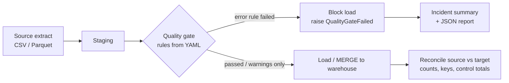

# data-quality-gates

[](https://github.com/svangala885-sv/data-quality-gates/actions/workflows/ci.yml)  

Config-driven data quality gates and post-load reconciliation for batch pipelines. A gate validates a staged extract against rules written in YAML and **stops the load** when an error-level rule fails, so bad data never reaches the warehouse or a dashboard. Failures produce a short incident summary that says what broke, how many rows, sample values and the most likely cause.

> **Portfolio note.** This is an independently written, representative project built with synthetic data. It is not code from, and does not describe the internal systems of, any employer or client.

## The problem it addresses

Pipelines usually fail loudly on crashes but silently on bad data: a replayed file creates duplicates, a source team adds a new status code, an amount column switches units. Without a gate those rows flow straight into reporting and are found by a business user. This repo shows the pattern I use: validate at the boundary, block on errors, warn on soft issues, reconcile after the load.

## Features

| Capability | Detail |
|---|---|
| Rules in YAML | `not_null`, `unique` (single or composite key), `in_range`, `accepted_values`, `regex`, `row_count`, `freshness` |
| Severity levels | `error` blocks the load, `warn` logs and continues |
| Tolerances | `max_failure_rate` per rule for known, accepted noise |
| Fail closed | A rule that raises (e.g. missing column) is recorded as a blocking failure, never a silent pass |
| Reconciliation | Row counts, missing / unexpected keys, control totals between source and target |
| Incident summary | Deterministic summary with likely cause; optional LLM hook adds notes but cannot replace the facts or break alerting |
| Orchestrator friendly | `enforce()` raises `QualityGateFailed`, so an Airflow / Databricks task fails and downstream tasks do not run |
| CLI + JSON report | `dq-gate --config ... --data ... --report report.json`; exit code 1 on failure |

## Architecture



## Quick start

```bash
python -m venv .venv && source .venv/bin/activate
pip install -e ".[dev]"
python scripts/generate_data.py          # synthetic data, already committed in data/
pytest -q
dq-gate --config config/orders.yaml --data data/orders_clean.csv
dq-gate --config config/orders.yaml --data data/orders_with_defects.csv --report report.json
```

Sample output for the defective extract:

```text
[orders] quality gate FAILED
- BLOCKING order_id_unique: 2/502 rows. ['order_id'] must be unique. e.g. ['ORD-000010', 'ORD-000010']
  Likely cause: Look for a replayed or double-delivered source file, or a join that fans out rows.
- BLOCKING customer_id_not_null: 1/502 rows. customer_id must not be null.
  Likely cause: Check for upstream schema changes or a source column that was renamed or dropped.
- BLOCKING amount_non_negative: 1/502 rows. amount_usd must be within [0, 100000]. e.g. [-15.0]
- BLOCKING status_valid: 1/502 rows. status must be one of [...]. e.g. ['RETURNED']
- WARN email_format: 1/502 rows. email must match [^@\s]+@[^@\s]+\.[a-z]{2,}. e.g. ['not-an-email']
```

### Docker

```bash
docker build -t dq-gates .
docker run --rm dq-gates                                    # validates the clean sample
docker run --rm -v "$PWD/data:/app/data" dq-gates --config config/orders.yaml --data data/orders_with_defects.csv
```

### Using it in a pipeline

```python
from dq_gates import QualityGate, reconcile

gate = QualityGate.from_yaml("config/orders.yaml")
gate.enforce(staged_df)            # raises QualityGateFailed -> task fails, downstream skipped
load(staged_df)
assert reconcile(staged_df, loaded_df, key="order_id", sum_columns=["amount_usd"]).passed
```

See `examples/airflow_dag.py` for the Airflow placement (illustrative, not run in CI).

## Configuration

```yaml
dataset: orders
rules:
  - {name: order_id_unique, type: unique, column: order_id}
  - {name: amount_non_negative, type: in_range, column: amount_usd, min: 0}
  - {name: email_format, type: regex, column: email, pattern: '...', severity: warn}
  - {name: customer_id_not_null, type: not_null, column: customer_id, max_failure_rate: 0.001}
```

## Project layout

```
src/dq_gates/   rules.py  gate.py  reconcile.py  explain.py  cli.py
config/         orders.yaml
data/           synthetic CSVs (generated by scripts/generate_data.py)
tests/          pytest suite (rules, gate, reconciliation, CLI)
examples/       airflow_dag.py
```

## Tech stack

Python 3.10+, pandas, PyYAML, pytest, ruff, Docker, GitHub Actions.

## Security considerations

- No credentials are needed or stored. The optional LLM hook receives only the summary text (rule names, counts and up to three sample values); remove samples before sending if a column can hold PII or PHI.
- Reports may contain sample values; write them to a location with the same access controls as the data.
- The container runs as a non-root user.

## Limitations and next steps

- pandas-based, so it suits extracts that fit in memory. The same rule specs map directly to PySpark expressions or to Great Expectations / Deequ suites for large tables; a Spark backend is the next step.
- No statistical anomaly rules yet (volume or distribution drift against history).
- Alert delivery (Slack, Teams, PagerDuty) is left to the orchestrator.

## License

MIT
